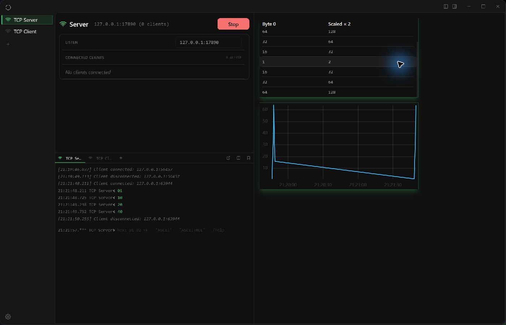

# LinkAssist

English | [中文](README.md)

LinkAssist is a Tauri 2 / React 19 / Rust desktop communication workbench for BLE, serial, TCP/UDP, protocol parsing, live canvases, Lua automation and MCP. Desktop commands and the local MCP Core share transport managers.

## Install and try

Windows 10/11 x64 previews require a recent Microsoft Edge WebView2 Runtime. Check [Releases](https://github.com/mingzhuuu/LinkAssist/releases) for published installers; build from source if none are available. Installers are currently unsigned; compare downloads against the matching `SHA256SUMS.txt`. macOS/Linux have not completed release validation.

Start without hardware using the [five-minute loopback guide](docs/QUICKSTART.md) and [`loopback.json`](config/layout/loopback.json). Device-specific examples require local port/device/project selection.



## Documentation

Detailed documentation is maintained in Chinese, with source links for each subsystem:

- [Feature guide](docs/FEATURES.md): entry points, workflows, outputs and limitations.
- [Architecture](docs/ARCHITECTURE.md): module boundaries, event routing and persistence.
- [Generated API and file index](docs/REFERENCE.md): Tauri commands, built-in MCP tools and owned files.
- [Development and validation](docs/DEVELOPMENT.md): reproducible commands and manual checks.
- [Audit and changes](docs/AUDIT.md): findings, implemented fixes and validation evidence.
- [MCP configuration](config/mcp/mcp-configuration-guide.md) and [Lua tool guide](config/mcp/mcp-tool-lua-guide.md).
- [Protocol guide](config/protocol/protocol-configuration-guide.md), [automation](config/script/script-configuration-guide.md) and [canvas lifecycle](config/script/canvas-lifecycle-guide.md).
- [Historical device-specific Agent example](AI_AGENT_DEMO.md).

## Features

| Domain | Implemented capabilities |
|---|---|
| Channels | BLE discovery/GATT/notifications; serial configuration and I/O; TCP client/server; UDP |
| Terminals | ASCII/HEX, timestamps, aggregate/channel routing, saved commands, splits, detach/reattach |
| Protocols | Passthrough, field definitions, Lua files, encoding, response matching and BLE transactions |
| Canvases | Tables, charts, forms and scripts; channel links, raw/parsed input, positioning and snapping |
| Automation | Lua steps, CSV, waits/retries/assertions, helpers, declarative UI and reports |
| Test runner | External pytest bridge catalog/profile/case selection, execution, logs and cancellation through Script Canvas |
| MCP | stdio bridge, authenticated localhost Core, built-in and configured Lua tools, asynchronous execution lookup |
| Persistence | Preferences, layouts, commands, script references and portable single-EXE configuration snapshots |
| Shell | Themes, simple mode, adjustable panels, tray and window restoration |

Implemented paths do not imply verified hardware support or cross-platform certification. Network receive compatibility commands may return empty data; the live UI consumes events.

## Development

Use Node.js **24.x** and Rust **1.94.1**, pinned in `rust-toolchain.toml`. Windows also needs Visual Studio C++ Build Tools, the Windows SDK and WebView2. See the [Tauri prerequisites](https://v2.tauri.app/start/prerequisites/).

Clone and start:

```bash
git clone --recurse-submodules https://github.com/mingzhuuu/LinkAssist.git
cd LinkAssist
npm ci
npm run tauri dev
```

`npm run dev` serves the frontend at `http://127.0.0.1:1420`. A normal browser does not provide Tauri IPC or native device access.

```bash
npm run check          # architecture/docs checks, TypeScript/build, Vitest
npm run tauri build    # native application and bundles
npm run docs:generate  # regenerate API and owned-file index after changes
```

Run `cargo test --lib --locked` inside `src-tauri` for Rust tests. Bundles are written to `src-tauri/target/release/bundle/`.

## MCP

Configure an MCP client to start the executable using an absolute path and `--mcp-bridge`:

```json
{
  "mcpServers": {
    "linkassist": {
      "command": "D:/Apps/LinkAssist/linkassist.exe",
      "args": ["--mcp-bridge"]
    }
  }
}
```

The client-specific wrapper may differ. The bridge discovers or starts a local Core using a dynamic loopback port and Bearer authentication. Only MCP Tools are implemented; Resources and Prompts are not. Use runtime `tools/list` for current schemas and enabled Lua tools.

## Configuration and snapshots

Normal configuration uses Tauri `app_data_dir()` with identifier `com.linkassist.desktop`: `%APPDATA%\com.linkassist.desktop\config.json` on Windows, the matching Application Support directory on macOS, and the XDG data directory on Linux.

```powershell
LinkAssist.exe snapshot my-workbench
```

This creates `my-workbench.exe` containing configuration and referenced scripts/static resources. Existing output is rejected. Runtime-selected CSV inputs, logs, Python environments and external test projects are excluded. Snapshot instances use isolated storage; Script Canvas auto-run and MCP are disabled by default in the snapshot.

## Contribution boundaries

Follow [AGENTS.md](AGENTS.md) and scoped instructions. Keep stores independent, receive listeners in window routing, and JSON contracts synchronized with Rust serde. Script Canvas requirements should be implemented in Lua when possible; application-level capability extensions require an explicit proposal and approval.

Project code is [MIT licensed](LICENSE). Dependencies and data retain their own licenses; see [third-party notices](THIRD_PARTY_NOTICES.md). See [Contributing](CONTRIBUTING.md), [Security](SECURITY.md) and [Changelog](CHANGELOG.md).
