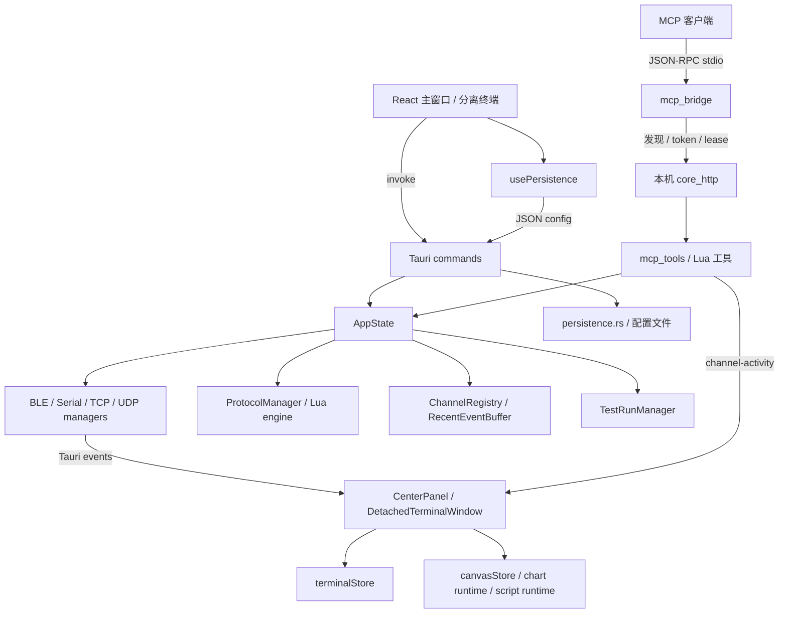
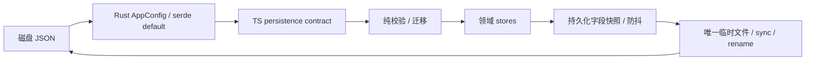

# LinkAssist 架构与模块边界

以当前实现为基线，先清理共享契约、生命周期和持久化边界，再逐步处理大型模块。功能定义见 [FEATURES](FEATURES.md)，每个源码文件与注册接口见 [REFERENCE](REFERENCE.md)。

## 1. 运行结构

Core 不是一个独立无 Tauri 的网络守护程序：隐藏 Core 仍基于 Tauri AppHandle 和同一 AppState。分离窗口共享后端，但有自己的 JS store；跨窗口状态不能按单一 React 树理解。

## 2. 文件组织与职责

| 目录/文件 | 当前职责 | 边界 |
|---|---|---|
| `src/App.tsx` | 主/分离路由、主题、停靠 | 不使用额外路由框架 |
| `src/components/layout/` | 壳、终端、事件收取、设置 | 接收监听留在窗口路由层 |
| `layout/eventSubscriptions.ts` | 监听注册/释放作用域 | 仅生命周期，不读 store、不决定数据路由 |
| `src/components/channels/` | BLE/UART/TCP 参数与动作 | 使用 hooks 和 store；UART 是现有目录名称 |
| `src/components/display/` | 四类画布、编辑、runtime、公式 | renderer 与 runtime 分工；脚本能力变更遵守 script-first |
| `src/hooks/` | invoke 包装、跨 store 编排、配置恢复 | 不另建接收监听 |
| `src/stores/` | 独立领域状态和操作 | 无 persist/devtools/immer；不互相 import 运行时状态 |
| `src/types/events.ts` | 传输/活动事件名到 payload 的映射 | 对齐 Rust serde；主/分离共享 |
| `src/types/persistence.ts` | 持久化 JSON 类型 | 不含 IO、迁移和 React；保留既有 JSON 字段名 |
| `src/lib/persistenceValidation.ts` | 纯校验 | 可独立测试；不修改 store、不调用 IPC |
| `src/lib/` 其他文件 | 命令发送、通道注册、测试 API、纯工具 | 避免成为聚合全部业务的入口 |
| `src-tauri/src/commands/` | Tauri 接口适配 | 注册到 lib.rs；错误类型保持兼容 |
| `src-tauri/src/{ble,serial,tcp,protocol}/` | 设备 I/O 与协议管理 | 长时间读取在任务中，不阻塞命令读循环 |
| `channel_registry.rs` / `channel_activity.rs` | 连接寻址、工具活动 | 逻辑 channelId 不等于 connectionId |
| `mcp_tools.rs` / `mcp_tool_script.rs` | 工具定义、调度、Lua 执行 | 定义和执行分支同步；业务编码应留在协议/脚本 |
| `core_http.rs` / `discovery.rs` | 本机 HTTP、鉴权、租约、发现 | 不暴露到外网；不将 token 写入公开文档 |
| `test_runner.rs` | 外部测试目录、子进程、结果、取消 | 固定 bridge 合同；不提供任意 shell 命令 |
| `persistence.rs` / `snapshot.rs` | 配置读写、资源打包/隔离 | 正常配置与便携快照分开 |
| `config/` | 用户可加载的 Lua、CSV、布局和使用教程 | 按 mcp/protocol/script/script-helper/layout 组织 |
| `scripts/project-check.mjs` | 静态契约检查与索引生成 | 不扫描依赖、编译产物和上游资料 |
| `registries/` / `bluetooth-numbers-database/` | 上游注册表/分配号资料 | 独立维护，不参与本次应用重构 |

type-only import 可复用 store 的现有快照类型，不产生运行时依赖；后续迁移领域类型时应同时更新调用方，避免为目录整齐批量移动文件。

## 3. 命令、事件和连接生命周期

命令方向：用户动作 → hook/API → Tauri command → AppState manager → 返回 Result → 更新 UI 状态。MCP 通过另一适配入口进入相同 manager，不复制协议实现。

数据方向：manager → serde payload → 事件 → 窗口路由 → 终端/画布/runtime。`src/types/events.ts` 约束事件名与对应 payload；TypeScript 的泛型不再由每个消费组件任意填写。事件类型仍是手工镜像，Rust 字段变化必须同步检查。

每个路由 effect 创建自己的 `createEventSubscriptions()`：

1. 注册时约束事件 payload，并在回调前检查作用域是否已释放。
2. 注册 promise 晚于卸载完成时，立即调用返回的 unlisten。
3. 注册失败记录具体事件；不会遗留无人处理的 promise rejection。
4. dispose 幂等；一个清理函数异常不妨碍其他监听清理。

监听仍位于主窗口与分离窗口，不通过全局事件总线或新增 hook 改变现有接收职责。初始化/窗口尺寸等其他监听尚未全部迁入该工具。

活动路由按明确 ID、已有连接映射或匹配的端点判断；网络端点回退匹配还要求当前配置模式一致且地址非空。明确的通道 ID 继续具有优先权，防止活动期间配置变化使已知绑定失效。

## 4. 配置与数据边界

`usePersistence` 保留 load/save 编排、窗口恢复和订阅防抖；类型与纯校验分别移出 hook。此次未更改保存文件格式，旧的可选终端字段仍兼容。非法树不会交给递归 renderer；其余配置继续加载。

每次 Rust 保存使用唯一临时文件，成功后原子替换目标；失败只删除本次临时文件。这保证并发写入不会共用同一个暂存文件，不提供配置版本锁或多用户字段合并，也不承诺文件系统/断电下的绝对持久性。

保留既有快照接口：terminalStore 和 commandStore 负责自身快照；canvasStore 负责运行时释放；hook 负责组合，不在 store 内互相读取。

## 5. 有界数据与资源释放

实时界面使用有限容量的事件、日志、图表和表格缓冲。队列容量是延迟/内存的取舍，详见功能说明；若需要无损采样，应设计独立记录链路和背压指标，再验证吞吐。

通道断开应清理连接映射、注册信息、相关订阅和画布就绪状态；画布移除应通过 `removeCanvas` 释放对应 runtime；测试取消应走协作退出和进程兜底流程。不得仅删除 UI 数组项而遗留后台任务。

## 6. 扩展与维护规则

| 变更 | 必须同步的部分 | 验证 |
|---|---|---|
| 新增 Tauri 命令 | commands、lib.rs 注册、TS 调用/类型 | 架构检查、类型检查、Rust 行为测试 |
| 新增事件字段 | Rust serde、events.ts、两个窗口路由 | 生命周期/路由测试，实际窗口联调 |
| 新增持久化字段 | Rust 默认值、TS 合同、加载/保存选择 | 旧配置恢复与新配置往返 |
| 新增 MCP 工具 | 定义、调用分支、权限/取消合同 | tools/list 与 tools/call 一致性 |
| 修改 Script Canvas 业务 | 首先修改 Lua/CSV/Helper 配置 | 示例解析与脚本场景；能力不足先请求批准 |
| 更改布局模型 | snapshot、恢复校验、拖拽/分离消费者 | 树约束、恢复、窗口联调 |
| 新增应用文件 | 目录职责、barrel、生成索引 | `npm run docs:generate`、`npm run check` |

`check:architecture` 检查静态 invoke 注册、已声明 Tauri 命令、跨 store 运行时导入、生成索引及文档文件链接。它不证明参数 serde 一致、动态 invoke 有效或真实设备正确。

## 7. 后续演进边界

大型 `CanvasEditDialog`、`scriptRuntime`、`SettingsDialog` 和 `mcp_tools` 仍有进一步拆分空间。应以功能域和可测合同拆分，而非一次性改名/搬迁；脚本 runtime 能力扩展仍受项目批准规则约束。

已识别但本次未实施的工作包括：无损采集/丢包指标、所有窗口辅助监听的统一管理、跨窗口恢复联调、多服务器/多 UDP 绑定、全量 IPC 类型生成和配置写入版本冲突处理。它们涉及功能设计或实际环境验证，不能算作本次已完成项。
